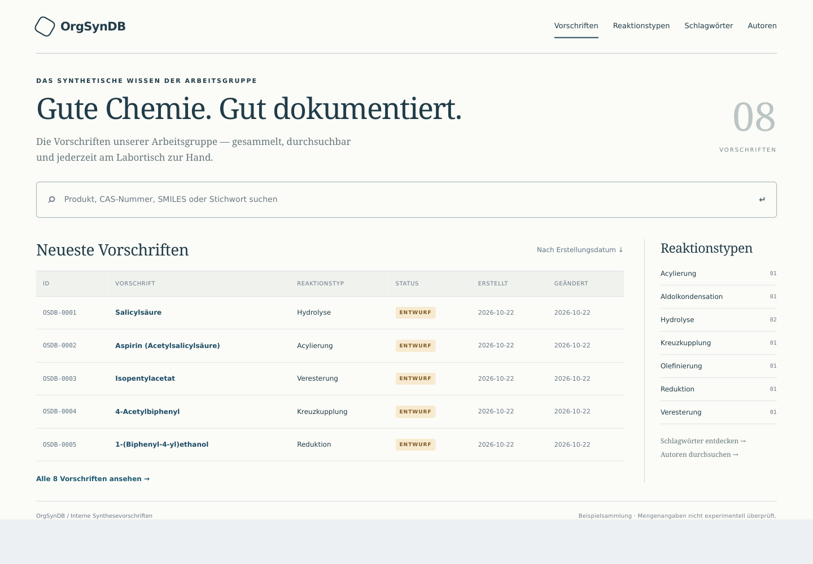
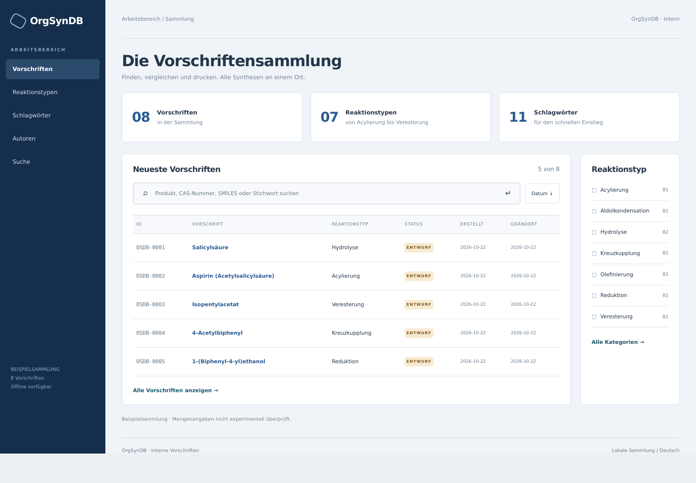
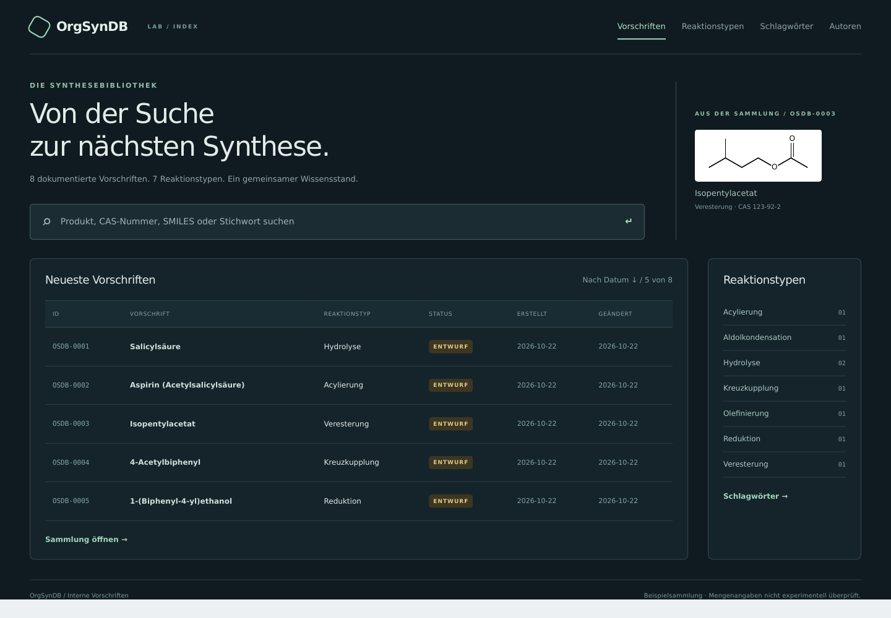

# Desktop design directions

These are static visual concepts using the German demo collection. The
layout fix retains the existing theme; these images propose a later visual
direction. Search, navigation and filters in the mockups are illustrative.

## 1. Reference library

A light paper surface, serif headings, restrained blue-green accents and
horizontal navigation. Best for reading and a traditional reference feel.

## 2. Research workbench — recommended

Persistent sidebar navigation, compact data panels and visible browsing
tools. Best for frequent desktop use and larger procedure collections.

## 3. Night lab

Dark surfaces, muted green accents and a featured compound preview. Best
for users who prefer a dark interface with a stronger visual identity.

Download [the comparison](design-options.html) and open it in a desktop
browser to switch between all three concepts. It needs no server or
external assets. The previews were rendered from HTML with WeasyPrint;
they are concept illustrations, not live-browser verification of the site.
