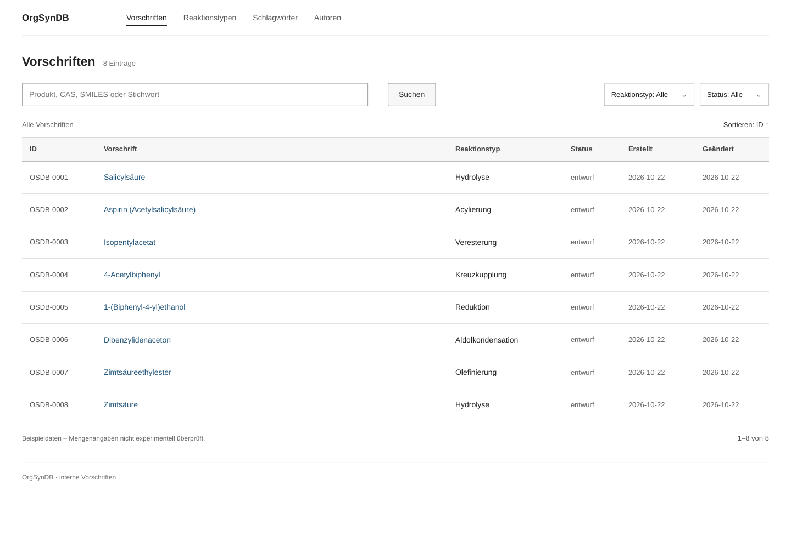
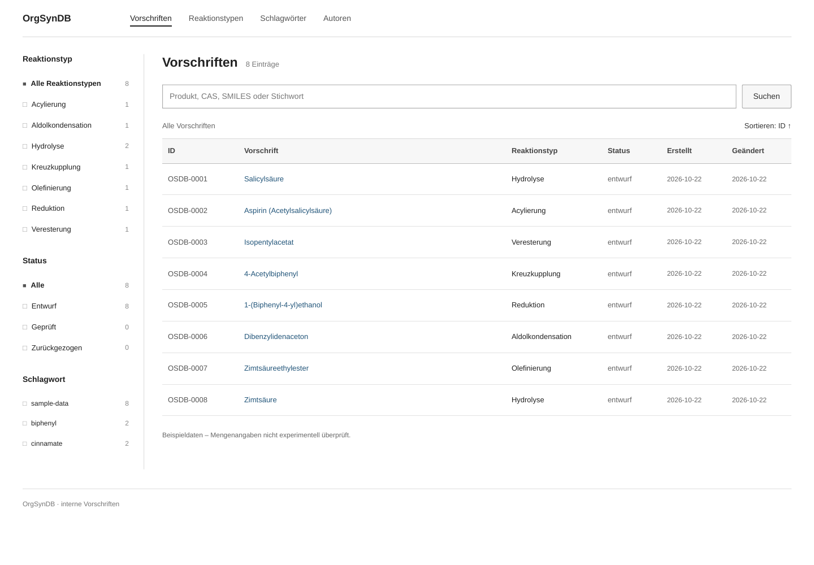
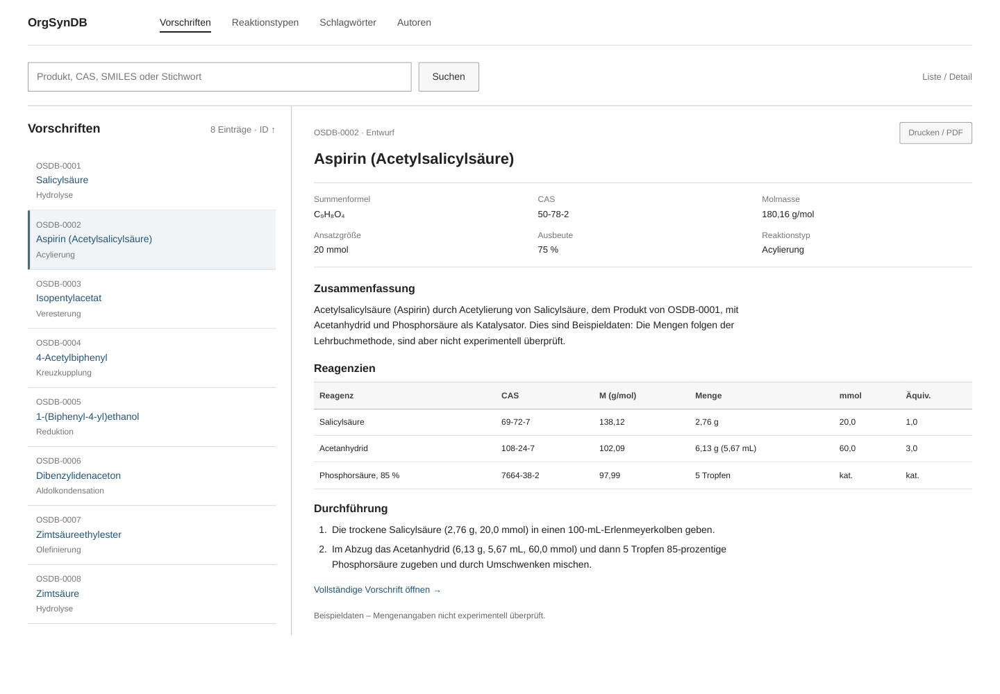
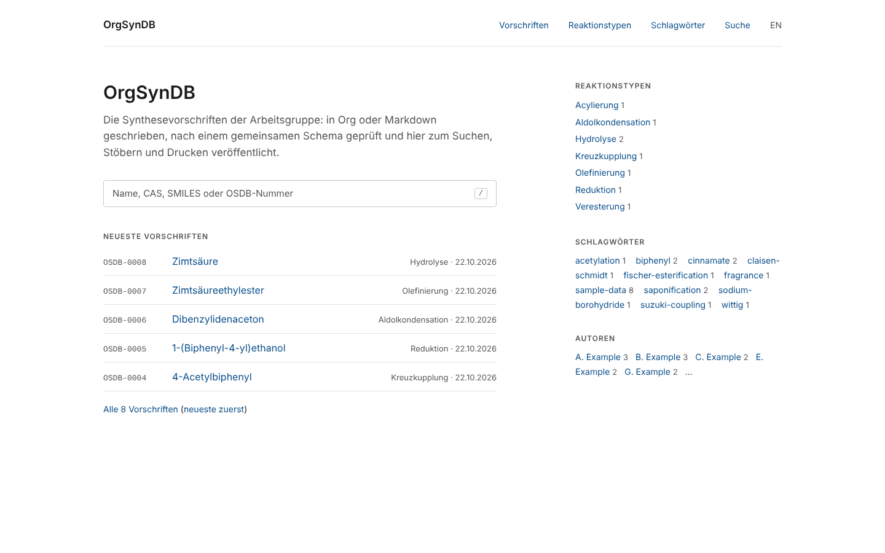
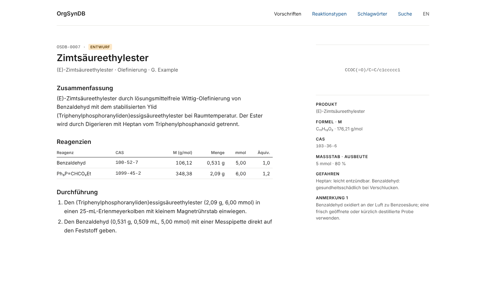
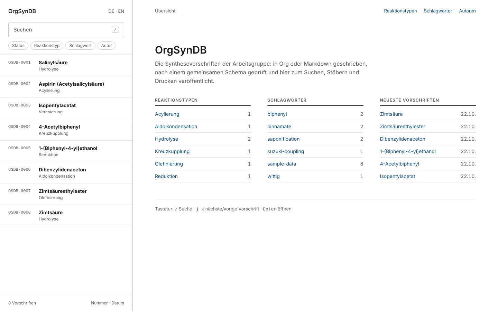
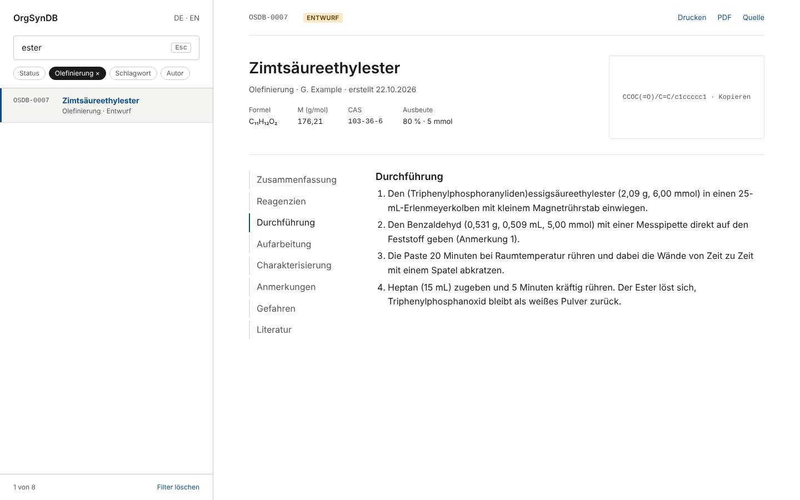
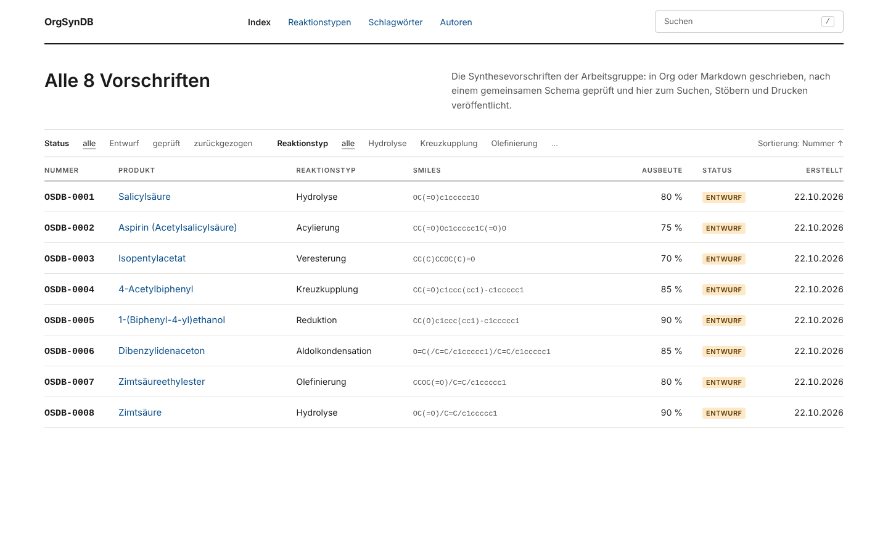
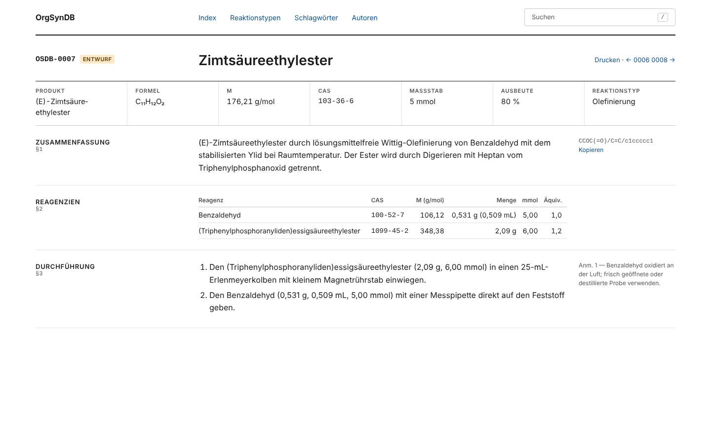

# Minimalist desktop layouts

All three use plain system sans-serif fonts, white backgrounds, thin
dividers and functional labels. The previews use the German demo data.

**Implemented:** layout 4 for the procedure lists and layout 7
(Marginalia) for procedure pages. The others remain proposals. See
`openspec/changes/desktop-layout/design.md` for what was built and what
differs from the mock-ups.

## 4. Full-width table

Search and filters above a table. Implemented for `/procedures/` and
`/procedures-by-date/`.

## 5. Filter sidebar

Persistent reaction-type, status and tag filters beside the table.

## 6. List and detail

The procedure list stays visible beside the selected procedure.

Download [the HTML comparison](minimal-layouts.html) and open it locally
to switch between layouts. These are static proposals, rendered from
HTML with WeasyPrint; the depicted search, filtering and selection
controls illustrate the proposed layout.

## Layouts 7–9

Three further layouts under the same constraints, each shown as a home
page and a procedure page. They keep the site's colour tokens and use
only system sans-serif, monospace for IDs, CAS numbers and SMILES, and
hairline rules instead of boxes. The interface text is the site's own
German strings. All frames are 1440 × 900 px Chromium renders of
[layouts-7-9.html](layouts-7-9.html), which needs no server or
external assets.

### 7. Marginalia

One reading column at the existing 70ch measure, left of centre. A wide
right margin holds the structure, product facts, hazards and numbered
notes beside the text, instead of above it. On the home page the same
margin lists reaction types, tags and authors. This is the only one of
4–9 that rearranges the procedure page itself. It is the closest to the
printed A4 page, and it is cheap: two grid columns in `screen.css` and a
partial that places each note beside its section.

### 8. Split index

A variant of 6: a fixed index pane holds the search field, the filter
chips and every procedure, and typing filters the list. The procedure
pane adds a section index beside the text and one row of key facts
under the title. The list pane must be a partial rendered into every
page, so that it works without JavaScript. It also needs a plan for
collections of several hundred procedures.

### 9. Ledger

A variant of 4 on a 12-column grid. The home page is the full index,
sortable by column, with the facets as one line of text toggles. A
procedure opens as a sheet: one band of key facts across the full
width, the section headings in columns 1–3, the text in 4–10 and the
notes in 11–12.

Layout 7 is implemented for procedure pages, without the sidenotes
beside their sections: the notes stay in the Notes section so that the
document order does not change.
